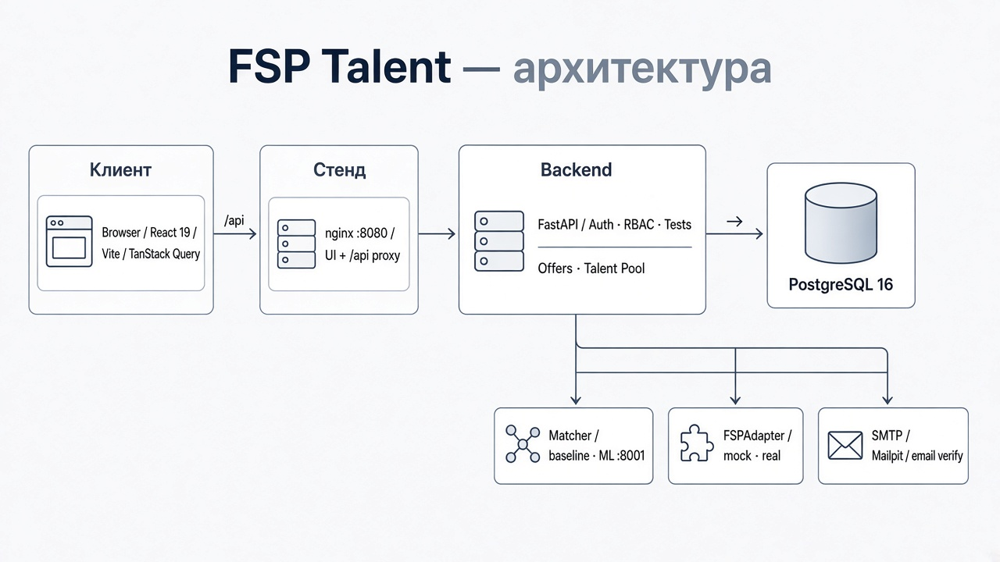
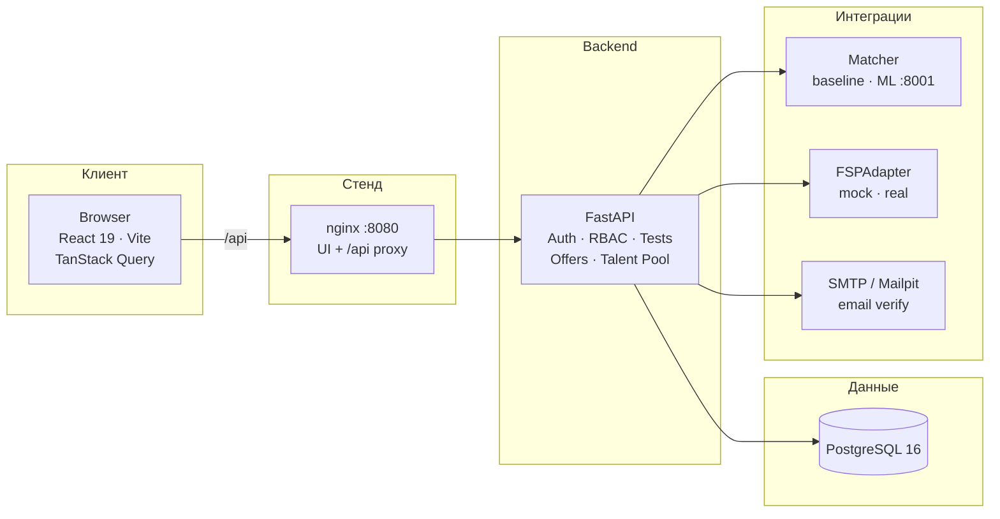

# FSP Talent

**Платформа обратного рекрутинга для ИТ:** работодатель находит подтверждённых кандидатов, кандидат получает адресные предложения с зарплатой — и только после принятия оффера открываются контакты.

Специальный трек хакатона ЛЦТ / ФСП. Репозиторий — monorepo: Frontend, Backend, ML-сервис матчинга и полный Docker-стенд для демо жюри.

---

## Оглавление

1. [Зачем этот продукт](#1-зачем-этот-продукт)
2. [Что сдаём жюри](#2-что-сдаём-жюри)
3. [Карта документации](#3-карта-документации)
4. [Архитектура](#4-архитектура)
5. [Быстрый старт](#5-быстрый-старт)
6. [Демо-аккаунты](#6-демо-аккаунты)
7. [Happy path: сквозной сценарий](#7-happy-path-сквозной-сценарий)
8. [Подбор и тестирование](#8-подбор-и-тестирование)
9. [Контракт API](#9-контракт-api)
10. [Auth и безопасность контактов](#10-auth-и-безопасность-контактов)
11. [Структура репозитория](#11-структура-репозитория)
12. [База данных](#12-база-данных)
13. [Интеграция с ФСП](#13-интеграция-с-фсп)
14. [Тесты и качество](#14-тесты-и-качество)
15. [Владение зонами кода](#15-владение-зонами-кода)
16. [Скрипты](#16-скрипты)
17. [Лицензия](#17-лицензия)

---

## 1. Зачем этот продукт

Классический рекрутинг в ИТ ломается на трёх точках:

| Проблема | Что происходит сейчас | Как отвечает FSP Talent |
| -------- | --------------------- | ---------------------- |
| Шум откликов | Сотни нерелевантных резюме на вакансию | Работодатель **сам** выбирает кандидатов из отфильтрованного Talent Pool |
| Самооценка вместо навыка | Грейд «Middle» в анкете ничем не подтверждён | Тест подтверждает пару **специализация + грейд**; без этого кандидата нет в пуле вакансии |
| Контакты слишком рано | Телефон и почта утекают до взаимного интереса | Контакты открываются **только после Accept** (или собственного отклика) — решение на Backend |

Целевая аудитория — компании, которые нанимают ИТ-специалистов, и соискатели, готовые подтвердить квалификацию. Участники соревнований ФСП — выделенный сегмент с дополнительным сигналом в ранжировании, но платформа **не** ограничивается ими: отсутствие истории ФСП корректно обрабатывается и не исключает из подбора.

Подробный путь пользователя (кандидат / работодатель) — в [`CJM.md`](./CJM.md).

---

## 2. Что сдаём жюри

| Критерий хакатона | Как закрываем |
| ----------------- | ------------- |
| Обратный рекрутинг | Talent Pool → оффер с зарплатой → Accept / Decline → раскрытие контактов |
| Explainable matching | Match Score 0–100 + структурированные причины (`SKILLS_REQUIRED`, `TEST_SCORE`, `FSP_VERIFIED`…) |
| Тестирование | Сессия из 10 вопросов, порог ≥ 70, подтверждённая категория без автодаунгрейда |
| ФСП | Адаптер mock/real, согласия, sync достижений; пустой ФСП = нулевой вклад, не ошибка |
| Документированный API | OpenAPI / Swagger, единый контракт FE ↔ BE, интеграционный тест контракта |
| Docker-стенд | `docker compose up` → UI + API + Postgres + Mailpit + ML |

Продуктовая логика подбора и теста (без «чёрного ящика»): [`APPROACH.md`](./APPROACH.md).

---

## 3. Карта документации

Читайте сверху вниз — от продукта к реализации.

### Продукт и требования

| Документ | Содержание |
| -------- | ---------- |
| **[README.md](./README.md)** (этот файл) | Обзор, запуск, архитектура, happy path, ссылки |
| [`APPROACH.md`](./APPROACH.md) | Выбранный подход: фильтр → Match Score → причины; механика теста |
| [`CJM.md`](./CJM.md) | Customer Journey Map: кандидат и работодатель |
| [`Backend.md`](./Backend.md) | Полное ТЗ Backend: модель данных, эндпоинты, инварианты |
| [`Frontend.md`](./Frontend.md) | Полное ТЗ Frontend: экраны, роли, DoD |
| [`ML.md`](./ML.md) | ТЗ ML-модуля: нормализация, score, ranking, демо-батч |

### Запуск и сервисы

| Документ | Содержание |
| -------- | ---------- |
| [`SETUP.md`](./SETUP.md) | Пошаговый стенд с нуля: Docker, локально, почта, типичные ошибки |
| [`backend/README.md`](./backend/README.md) | FastAPI: конфиг, сиды, matcher, FSP, health, prod-режим |
| [`frontend/README.md`](./frontend/README.md) | React: MSW-демо, прокси, стек, структура `src/` |
| [`frontend/UI_KIT.md`](./frontend/UI_KIT.md) | Токены, shared UI, domain-компоненты; живой каталог `/ui-kit` |
| [`ml/README.md`](./ml/README.md) | Explainable matcher: `/rank`, веса, fallback, pytest |

---

## 4. Архитектура

<p align="center">
  
</p>



| Папка | Стек | Порт (dev) | Документация |
| ----- | ---- | ---------- | ------------ |
| [`frontend/`](./frontend/) | React 19, Vite, TanStack Query, MSW | `:5173` | [`frontend/README.md`](./frontend/README.md), [`UI_KIT.md`](./frontend/UI_KIT.md) |
| [`backend/`](./backend/) | FastAPI, SQLAlchemy 2, Alembic, PostgreSQL 16 | `:8000` | [`backend/README.md`](./backend/README.md) |
| [`ml/`](./ml/) | FastAPI, explainable scoring | `:8001` | [`ml/README.md`](./ml/README.md) |
| [`compose.yaml`](./compose.yaml) | Postgres + backend + frontend (nginx) + Mailpit + ml | UI `:8080` | ниже и [`SETUP.md`](./SETUP.md) |

### Границы ответственности

| Делает Backend / ML | Делает Frontend |
| ------------------- | --------------- |
| Auth (JWT), RBAC, подтверждение email | UI логина/регистрации, хранение access token, guards |
| Match Score, ranking, Skill Radar, аналитика | Только отображение DTO |
| Генерация вопросов, правильные ответы, оценка | Вопросы без `correct`, прогресс, UI результата |
| FSP sync через адаптер, согласия | Кнопка sync, согласие, список достижений |
| Раскрытие контактов после Accept | Показ контактов **только** из успешного API |
| Аудит, уведомления, бизнес-правила | Валидация форм (Zod), empty / loading / error |

**Анти-цели Frontend:** не считать match/test на клиенте; не ходить в ФСП напрямую; не «раскрывать» контакты по статусу оффера в обход API.

**Контракт API один.** Backend реализует то, что вызывает фронтенд:

- пути — `frontend/src/shared/api/endpoints.ts`
- типы — `frontend/src/entities/types.ts`
- поведение — `frontend/src/mocks/handlers.ts`

Рассинхрон ловит `backend/tests/integration/test_frontend_contract.py`.

---

## 5. Быстрый старт

Полная инструкция для новых участников (почта, Windows/PowerShell, частые проблемы) — в [`SETUP.md`](./SETUP.md).

### 5.1. Весь стенд в Docker (рекомендуется для демо жюри)

Нужны Docker / OrbStack / Docker Desktop, `POSTGRES_PASSWORD` в корневом `.env`, `backend/.env` из `backend/.env.example` (минимум `JWT_SECRET`).

```bash
docker compose up -d --build
```

| Адрес | Что открыть |
| ----- | ----------- |
| [http://localhost:8080](http://localhost:8080) | UI + прокси `/api` |
| [http://localhost:8080/api/docs](http://localhost:8080/api/docs) | Swagger |
| [http://localhost:8025](http://localhost:8025) | Mailpit — письма подтверждения email |
| [http://localhost:8001/health](http://localhost:8001/health) | ML-сервис (если поднят) |

Миграции и демо-сиды применяются при старте backend. Prod-режим, SMTP для жюри, rate limit — в [`backend/README.md`](./backend/README.md).

Чтобы гнать ranking через ML-сервис (иначе по умолчанию in-process `BaselineMatcher`):

```bash
MATCHER_PROVIDER=ml docker compose up -d --build
```

При недоступности ML Backend автоматически падает на baseline с той же формулой Talent Pool.

### 5.2. Локально: Backend + Frontend

```bash
# Backend (Python 3.12+, uv, Postgres из backend/.env)
cd backend
uv sync
uv run alembic upgrade head
uv run python -m app.seed
uv run uvicorn app.main:app --reload --port 8000

# Frontend (другой терминал): Vite проксирует /api → :8000
cd frontend
npm install
npm run dev   # http://localhost:5173
```

Swagger: [http://localhost:8000/api/docs](http://localhost:8000/api/docs)  
Health: `GET /api/health/live`, `GET /api/health/ready`.

Опционально ML:

```bash
cd ml
uv sync --group dev
uv run uvicorn app.main:app --reload --port 8001
# в backend/.env: MATCHER_PROVIDER=ml, ML_MATCHER_URL=http://localhost:8001
```

### 5.3. Только Frontend на моках (бэкенд не нужен)

```bash
cd frontend
VITE_USE_MOCKS=true npm run dev
```

MSW перехватывает `/api` в браузере. Подробности — [`frontend/README.md`](./frontend/README.md).

---

## 6. Демо-аккаунты

Одинаковые для MSW и реального Backend. Пароль для всех: `demo1234` (только демо-стенд).

| Роль | Email | Профиль |
| ---- | ----- | ------- |
| admin | `admin@demo.ru` | Админ FSP Talent |
| employer | `employer@demo.ru` | Игорь Смирнов, Resonance Labs |
| employer | `employer2@demo.ru` | Ольга Петрова, ТехноСфера |
| candidate | `candidate@demo.ru` | Анна Ковалёва, Frontend middle, тест 82, ФСП |
| candidate | `maxim@demo.ru` … | ещё именованные + фоновые кандидаты в сиде |

Демо-пара для ранжирования и mock-ID ФСП — в [`backend/README.md`](./backend/README.md).

---

## 7. Happy path: сквозной сценарий

Именно этот сценарий — смысловой центр ТЗ (обратный подбор).

1. **Employer** регистрируется, подтверждает email, создаёт **вакансию** (компания создаётся из `companyName`).
2. **Candidate** заполняет профиль и навыки, при желании синхронизирует ФСП (с согласием), проходит **тест** → подтверждённая категория.
3. Employer открывает **Talent Pool** по вакансии → видит **score + причины** (плюсы и минусы).
4. Employer отправляет **оффер** с зарплатой в рублях.
5. Candidate открывает оффер (`viewed`) → **accept** или **decline**.
6. Employer запрашивает **контакты** — только после accept; до этого `403 CONTACTS_LOCKED`.
7. Match и результат теста **не** считаются на фронте.

Автотесты этого пути:

- Frontend (MSW): `frontend/src/shared/api/p0.dod.test.ts`
- Backend (Postgres): `backend/tests/integration/test_golden_path.py`

---

## 8. Подбор и тестирование

Кратко. Полный разбор решений и «почему не нейросеть без датасета» — в [`APPROACH.md`](./APPROACH.md); спецификация ML — в [`ML.md`](./ML.md) и [`ml/README.md`](./ml/README.md).

### Две ступени

```text
Кандидат: профиль → тест → подтверждённая категория → (опционально ФСП)
                              ↓
Работодатель: вакансия → Talent Pool (жёсткий фильтр по категории)
                              ↓
                 матчер: Match Score + причины + стабильный порядок
```

| Ступень | Что происходит |
| ------- | -------------- |
| Жёсткий фильтр | В выдаче по вакансии только кандидаты с подтверждённой специализацией и грейдом этой вакансии |
| Мягкий score 0–100 | Сортировка внутри уже отфильтрованного пула |

### Формула Match Score (Talent Pool)

```text
score = 0.50·test + 0.25·skills + 0.15·fsp + 0.10·conditions
```

| Компонент | Вес | Смысл |
| --------- | --- | ----- |
| test | 50% | Балл теста в той же категории |
| skills | 25% | Взвешенное пересечение стека (обязательный навык ×2, желательный ×1) |
| fsp | 15% | Только `verified` достижения; пустой ФСП → 0, без штрафа исключением |
| conditions | 10% | Формат работы и потолок зарплаты |

Специализацию внутри `/rank` повторно не начисляем: Backend уже отфильтровал категорию. Навыки нормализуются (`React.js` → `React`, `TS` → `TypeScript`).

### Тест

- 10 вопросов по blueprint (generators + ограниченный static-пул).
- Пропуск = ошибка; порог **≥ 70** → категория подтверждена.
- Провал **не** понижает заявленный грейд и не откатывает уже подтверждённую категорию.
- Правильные ответы на Frontend до `finish` не отдаются.

---

## 9. Контракт API

Префикс: **`/api`**. Ошибки — плоский объект; UI показывает `message`:

```json
{
  "message": "Контакты доступны после принятия предложения",
  "code": "CONTACTS_LOCKED",
  "details": {},
  "requestId": "req_…"
}
```

| Группа | Пути |
| ------ | ---- |
| Справочники | `GET /specializations`, `/grades`, `/skills?q=` |
| Кандидат: профиль | `GET/PATCH/DELETE /candidates/me`, `…/completeness`, `…/consents` |
| Кандидат: ФСП | `GET …/fsp/achievements`, `POST …/fsp/sync`, `PUT/DELETE …/fsp/link` |
| Talent Pool | `GET /candidates?…` (фильтры, `vacancyId`, sort, page) |
| Карточка кандидата | `GET /candidates/{id}`, `…/contacts`, `…/fsp/achievements`, `…/skill-radar` |
| Работодатель | вакансии, офферы, shortlist, compare, company |
| Вакансии (каталог) | список, match-to-me, apply, parse |
| Офферы | `POST /offers`, `GET /offers/{id}`, `…/accept`, `…/decline` |
| Тесты | sessions → question → answer → finish → result + history |
| Уведомления | list / read / read-all |
| Дашборды | candidate / employer / employer analytics |
| Admin | overview, users, offers, vacancies |
| Career Passport | своя ссылка `/p/<имя>-<токен>`; публичный `GET /public/passports/{slug}` только с согласием |

Полные схемы — Swagger. Изменение контракта: править `frontend/src/entities/types.ts` и backend schemas **вместе**.

---

## 10. Auth и безопасность контактов

| Шаг | Method / Path | Поведение |
| --- | ------------- | --------- |
| Регистрация | `POST /api/auth/register` | → `{ accessToken, user }` + письмо со ссылкой |
| Логин | `POST /api/auth/login` | неподтверждённый email вход не блокирует |
| Me | `GET /api/auth/me` | `AuthUser` + `emailVerified` |
| Logout | `POST /api/auth/logout` | отзыв сессии |
| Подтверждение | ссылка / `POST /api/auth/verify-email` | `{ ok: true }` |
| Повтор письма | `POST /api/auth/resend-verification` | `{ ok: true }` |

- Access token: **8 часов**, `Authorization: Bearer …` (у фронта нет refresh в UI-потоке).
- Пока email не подтверждён: работодатель не шлёт офферы (`403 EMAIL_NOT_VERIFIED`), кандидат не виден в Talent Pool.
- Контакты кандидата: `GET /candidates/{id}/contacts` → успех только после Accept (или сценария отклика); иначе `CONTACTS_LOCKED`.

---

## 11. Структура репозитория

```text
LCT_Resonance/
├── README.md                 ← вы здесь
├── SETUP.md                  ← пошаговый запуск
├── APPROACH.md               ← логика подбора и теста
├── Backend.md / Frontend.md / ML.md / CJM.md
├── compose.yaml              ← postgres + backend + frontend + mailpit + ml
├── frontend/
│   ├── src/
│   │   ├── app/              # router, layouts, guards
│   │   ├── pages/            # экраны по ролям
│   │   ├── entities/         # типы (контракт) + domain UI
│   │   ├── features/         # auth, notifications
│   │   ├── mocks/            # MSW handlers + fixtures
│   │   └── shared/api/       # apiClient, endpoints
│   ├── UI_KIT.md
│   └── README.md
├── backend/
│   ├── app/
│   │   ├── api/routes/       # HTTP под /api
│   │   ├── services/         # бизнес-логика
│   │   ├── models/           # SQLAlchemy
│   │   ├── schemas/          # Pydantic DTO (camelCase)
│   │   ├── integrations/     # FSP, matcher, email
│   │   ├── seed/             # демо-данные
│   │   └── core/             # config, security, deps
│   ├── alembic/
│   ├── tests/
│   └── README.md
└── ml/
    ├── app/                  # /rank, normalize, categorize, …
    ├── tests/
    └── README.md
```

---

## 12. База данных

- PostgreSQL 16 (compose) или локальный инстанс.
- Миграции: `uv run alembic upgrade head`; проверка рассинхрона моделей — `uv run alembic check`.
- Сиды: `uv run python -m app.seed` (идемпотентно: повтор → `SEED_SKIP`).
- Основные таблицы: `users`, `candidate_profiles`, `companies`, `vacancies`, `offers`, `fsp_*`, `test_*`, `notifications`, `shortlist_items`, `applications`, `saved_vacancies`, `consents`, taxonomy.

Модель и инварианты — в [`Backend.md`](./Backend.md).

---

## 13. Интеграция с ФСП

На хакатоне реального API ФСП нет. Реализован `FSPAdapter`:

| Реализация | Когда |
| ---------- | ----- |
| `MockFSPAdapter` | Демо и тесты (`FSP_PROVIDER=mock`) |
| `RealFSPAdapter` | Контракт под будущее API (`FSP_PROVIDER=real`) |

- Sync только после согласия кандидата.
- В ranking учитываются подтверждённые (`verified`) достижения; дисциплина и тип результата влияют на вклад.
- Кандидат **без** истории ФСП остаётся в пуле; компонент `fsp` просто даёт 0.

---

## 14. Тесты и качество

| Слой | Команда | Что проверяет |
| ---- | ------- | ------------- |
| Frontend unit / DoD | `cd frontend && npm run test` | контрактные сценарии на MSW |
| Backend unit | `cd backend && uv run pytest tests/unit -q` | без БД |
| Backend integration | `uv run pytest tests/integration -q` | golden path, контракт с фронтом (нужен Postgres + seed) |
| ML | `cd ml && uv run pytest` | scoring, demo batch из [`ML.md`](./ML.md) |

Линт фронта: `npm run lint`. Сборка: `npm run build`.

---

## 15. Владение зонами кода

| Зона | Owner | Не ломать без синка |
| ---- | ----- | ------------------- |
| `frontend/src/entities/types.ts`, `shared/api` | Frontend + Backend | контракт; менять вместе |
| `backend/app/api`, `schemas`, OpenAPI | Backend | контракт для FE |
| `frontend/src/mocks/*` | Frontend | только демо; формулы не копировать в prod UI |
| `frontend/UI_KIT.md`, `shared/ui` | Frontend | визуал |
| `backend/integrations/fsp`, `matching` | Backend | адаптеры |
| `ml/` | ML | ranking / normalize; клиент — только Backend |
| `compose.yaml`, миграции | Backend / DevOps | стенд жюри |

---

## 16. Скрипты

### Frontend

```bash
npm run dev                       # :5173, /api → :8000
VITE_USE_MOCKS=true npm run dev   # демо на MSW
npm run build
npm run test
npm run lint
```

### Backend

```bash
uv sync
uv run alembic upgrade head
uv run python -m app.seed
uv run uvicorn app.main:app --reload --port 8000
uv run pytest tests/unit -q
uv run pytest tests/integration -q
```

### ML

```bash
cd ml
uv sync --group dev
uv run uvicorn app.main:app --reload --port 8001
uv run pytest
uv run pytest tests/test_demo_batch.py -q
```

### Compose

```bash
docker compose up -d --build
docker compose logs -f backend
docker compose ps
docker compose down          # данные Postgres сохранятся
docker compose down -v       # чистая база + повторный seed при старте
```

---

## 17. Лицензия

См. [`LICENSE`](./LICENSE).

---

### Для жюри за 60 секунд

1. `docker compose up -d --build`
2. Открыть [http://localhost:8080](http://localhost:8080)
3. Войти как `employer@demo.ru` / `demo1234` → Talent Pool по вакансии → score и причины
4. Войти как `candidate@demo.ru` / `demo1234` → офферы → Accept
5. Снова работодатель → контакты открыты
6. Письма: [http://localhost:8025](http://localhost:8025) · API: [http://localhost:8080/api/docs](http://localhost:8080/api/docs)

Вопросы по подходу к matching и тестам — [`APPROACH.md`](./APPROACH.md). Пошаговый стенд — [`SETUP.md`](./SETUP.md).
