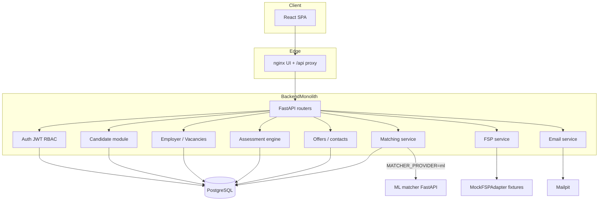
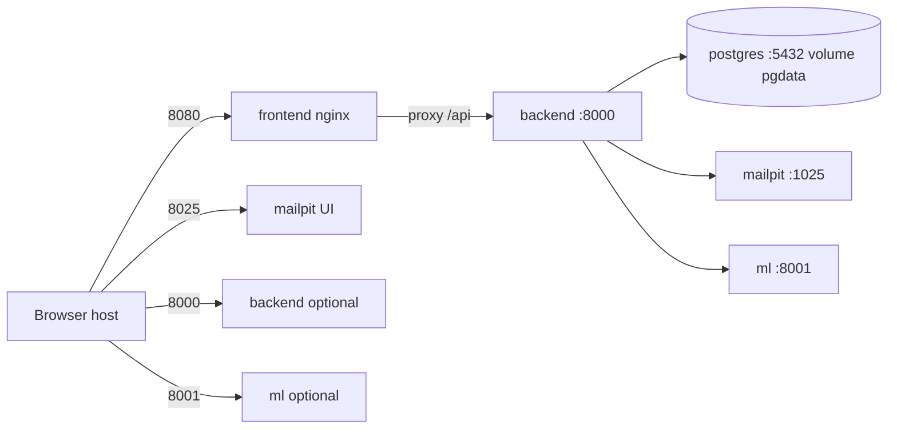

# 03. Архитектура FSP Talent

## 1. Общая схема

```text
Пользователь (браузер)
        │
        ▼
 React Frontend (Vite) ─── в Docker: nginx :8080
        │  /api/*
        ▼
 FastAPI Backend :8000
        ├── PostgreSQL 16
        ├── Matcher (in-process BaselineMatcher ИЛИ HTTP → ML :8001)
        ├── FSPAdapter (mock | real stub)
        └── SMTP / Mailpit :1025 (UI :8025)
```

Изображение стенда: `docs/assets/architecture/architecture.jpg` (также `docs/architecture.jpg`).

Это **модульный монолит** Backend + отдельный опциональный ML HTTP-сервис + SPA Frontend. Микросервисов (отдельный auth-service, assessment-service и т.п.) нет.

---

## 2. Компонентная диаграмма



---

## 3. Потоки данных

### 3.1. Регистрация и авторизация

1. UI `POST /api/auth/register` → создаётся `users` + профиль/компания по роли → access JWT + refresh cookie → письмо verify.
2. В `APP_ENV=dev` токен может вернуться в заголовке `X-Verification-Token` (обход почты).
3. В compose по умолчанию `APP_ENV=prod` — письмо в Mailpit.
4. `GET /api/auth/me` восстанавливает сессию по Bearer.
5. Неподтверждённый email: вход разрешён; Talent Pool и офферы работодателя ограничены.

### 3.2. Опрос / профиль и тестирование

1. Кандидат заполняет профиль (специализация, заявленный грейд, навыки).
2. `POST /api/tests/sessions` с spec+grade → 10 вопросов (static + generated).
3. Answer → finish → score; при ≥ PASS_SCORE (70) пишутся verified_* поля.

### 3.3. Категоризация

Подтверждённая категория = пара `(verified_specialization_id, verified_grade_id)`.  
Мягкая ML-категоризация (`POST /categorize` на ML) Backend в прод-пути **не вызывает**.

### 3.4. Поиск и matching

1. Employer создаёт вакансию со spec+grade+skills.
2. `GET /api/candidates?vacancyId=` → жёсткий фильтр категории → `match_profiles` → score+reasons.
3. При `MATCHER_PROVIDER=ml` — HTTP `POST {ML_MATCHER_URL}/rank`, иначе BaselineMatcher; при ошибке ML — fallback.

### 3.5. Приглашение и контакты

1. `POST /api/offers` (employer email verified).
2. Кандидат accept/decline.
3. `GET /api/candidates/{id}/contacts` успешен только если есть accepted offer или application на вакансию компании; иначе `403 CONTACTS_LOCKED`.

### 3.6. Достижения ФСП

1. Согласие `fsp_sync`.
2. `POST /api/candidates/me/fsp/sync` → MockFSPAdapter читает JSON fixtures.
3. В ranking учитываются только `verified=true`.

---

## 4. Архитектурные решения

| Решение | Почему |
| ------- | ------ |
| FastAPI + SQLAlchemy + Alembic | OpenAPI из коробки, async Postgres, миграции — закрывает требование документированного API |
| React 19 + Vite + TanStack Query | быстрый SPA, единый контракт с MSW для параллельной разработки FE |
| Explainable rule-based matching | нет размеченного датасета; жюри требует «почему этот кандидат» |
| FSPAdapter mock/real | официального API ФСП нет; бизнес-логика не зависит от HTTP деталей реестра |
| Baseline всегда доступен | демо жюри не падает, если ML-контейнер недоступен |
| Контакты только через API | Frontend не «угадывает» раскрытие по статусу оффера |
| Монолит Backend | 4-дневный хакатон; логическое разделение модулей без сетевых границ |

Кеширование: FSP sync cache TTL (`FSP_CACHE_TTL_HOURS`, default 24). HTTP-кеша Talent Pool нет. Rate limit — in-memory per IP/user.

Ошибки внешних сервисов: SMTP в prod → 503 на регистрацию; ML → fallback baseline; FSP provider errors → stale cache / статусы sync.

---

## 5. Deployment



| Сервис | Внешний порт | Внутренний | Том |
| ------ | ------------ | ---------- | --- |
| frontend | 8080→80 | — | — |
| backend | 8000 | 8000 | — |
| postgres | 5432 | 5432 | `pgdata` |
| mailpit | 8025, 1025 | — | — |
| ml | 8001 | 8001 | — |

Публичный деплой (заготовка): Backend на Render (`render.yaml`), Frontend на Vercel (`frontend/vercel.json`). Проверенный постоянный URL стенда в документации **не указан** — требуется добавить командой после деплоя.

---

## 6. Структура репозитория (логика)

```text
LCT_Resonance/
├── frontend/     SPA + nginx image
├── backend/      FastAPI + Alembic + seed + tests
├── ml/           explainable matcher HTTP
├── compose.yaml  полный стенд
├── docs/         этот комплект документации
├── README.md, SETUP.md, APPROACH.md, …
```

Границы ответственности и владельцы зон — в корневом `README.md`, раздел «Владение зонами кода».
