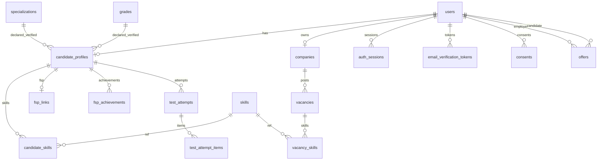

# 04. База данных

СУБД: **PostgreSQL 16** (образ `postgres:16-alpine` в compose). ORM: SQLAlchemy 2 async. Миграции: Alembic (`backend/alembic/versions/`).

---

## 1. ER-диаграмма (основные сущности)



Полный список из миграции `0001_initial_schema.py`: grades, skills, specializations, users, audit_events, auth_sessions, candidate_profiles, companies, consents, email_verification_tokens, notifications, test_questions, candidate_skills, fsp_links, fsp_achievements, profile_views, shortlist_items, test_attempts, vacancies, applications, offers, saved_vacancies, test_attempt_items, vacancy_skills. Миграция `0002_passport_token.py` добавляет `candidate_profiles.passport_token`.

---

## 2. Справочник ключевых таблиц

### users

- PK: `id` (UUID)
- Поля: `email` (unique), `password_hash`, `role` (candidate|employer|admin), `email_verified_at`, `status` (active|blocked), display name и т.д.
- Связи: sessions, candidate_profile, company (employer)

### candidate_profiles

- PK: `user_id` → users
- Заявленные: specialization/grade (declared)
- Подтверждённые: `verified_specialization_id`, `verified_grade_id`, `grade_verification_status`, `last_test_score`, `last_grade_change_at`
- Условия: salary_from/to, work_format, city, readiness, profile_visibility, contacts_visibility
- `passport_token` — публичный паспорт

### companies / vacancies / vacancy_skills

- Компания: один owner employer
- Вакансия: spec, grade, salary RUB, status, snapshot `company_name`
- Skills: `required` bool, `weight`

### offers

- employer_user_id, candidate_user_id, company_id, optional vacancy_id
- salary_from/to, currency RUB, status, employer_contact JSONB

### test_* 

- `test_questions` — банк static
- `test_attempts` — сессия: score, passed, status, expires_at, current_index
- `test_attempt_items` — snapshot вопроса, source static|generated, seed, ответ кандидата (correct на Frontend не отдаётся)

### fsp_*

- `fsp_links`: fsp_member_id, sync_status, raw_snapshot
- `fsp_achievements`: external_id, type, discipline, verified, sport_rank, …

### engagement

- shortlist_items, applications, saved_vacancies, profile_views, notifications

### taxonomy

- specializations (slug), grades (code, rank 0–4), skills (slug)

### audit_events

- action, entity_type, metadata JSONB, actor

---

## 3. Бизнес-правила в данных

| Правило | Реализация |
| ------- | ---------- |
| Заявленный ≠ подтверждённый грейд | отдельные колонки declared/verified |
| Провал теста не понижает verified | update verified только при passed |
| Cooldown смены категории | `last_grade_change_at` + GRADE_COOLDOWN_DAYS=90 |
| История тестов | множество `test_attempts` |
| ФСП опционален | отсутствие link/achievements допустимо |
| Контакты | не отдаются в обычном profile DTO; отдельный endpoint после unlock |
| Согласия на публикацию паспорта | consents + visibility |
| Talent Pool visibility | active + email_verified + visibility employers/public |

Отдельной таблицы «search session» нет: контекст поиска — query-параметры UI.

---

## 4. Миграции

```bash
cd backend
uv run alembic upgrade head      # применить
uv run alembic current           # текущая ревизия
uv run alembic check             # рассинхрон моделей (если настроен)
uv run alembic revision --autogenerate -m "msg"   # новая (осторожно на проде)
```

Опасные операции: `downgrade` с потерей колонок; `docker compose down -v` удаляет volume `pgdata`.

В Docker миграции гоняются при старте backend-контейнера.

---

## 5. Демо-данные (seed)

```bash
cd backend
uv run python -m app.seed
# повтор → SEED_SKIP (если specializations уже есть)
```

В compose: `SEED_ON_START=true` (по умолчанию).

Создаёт: taxonomy (7 spec, 5 grades, 30 skills), банк вопросов, admin/employers/candidates, компании, вакансии, офферы, FSP для части кандидатов, shortlist/applications/views.

Пароль всех демо-аккаунтов: `demo1234` (только демо-стенд).

Очистка демо: безопасного «удалить только seed» скрипта нет. Для чистого стенда: `docker compose down -v` и повторный `up` (уничтожит всю БД volume).
