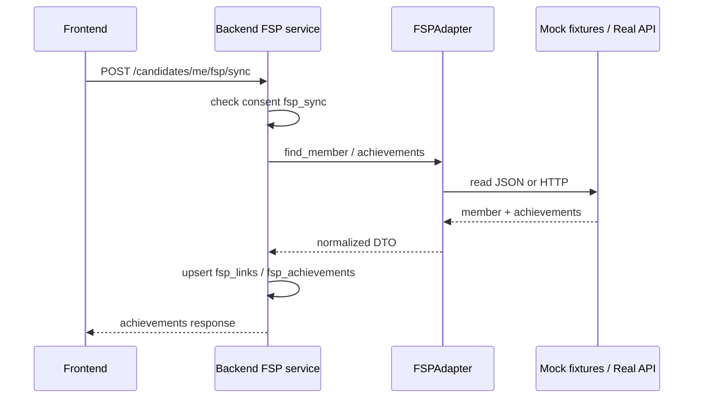

# 10. Интеграция с ФСП

**Факт хакатона:** официальное API и структура реестра ФСП организаторами **не предоставлены**. Это зафиксировано во внутренних спецификациях (`Backend.md`) и отражено в коде через адаптер.

Нельзя формулировать «официально подтверждено ФСП» для mock-данных.

---

## 1. Три уровня

| Уровень | Что есть |
| ------- | -------- |
| Фактическая реализация | `FSPAdapter` protocol; `MockFSPAdapter`; сервис sync/link; таблицы `fsp_links`, `fsp_achievements`; UI `/candidate/fsp`; вклад в Match Score |
| Демонстрационная интеграция | JSON fixtures `backend/app/integrations/fsp/fixtures/members.json`, `achievements.json`; seed привязывает `FSP-2026-00123` к Анне и др. |
| Будущая интеграция | `RealFSPAdapter` (HTTP stub на `FSP_BASE_URL` + Bearer); возможный переход auth на Keycloak/OIDC (не реализован) |

---

## 2. Как хранится FSP ID

- Таблица `fsp_links`: `candidate_user_id`, `fsp_member_id`, `sync_status`, `raw_snapshot`.
- API: `PUT /api/candidates/me/fsp/link`, `DELETE …/link`, `POST …/fsp/sync`.

---

## 3. Достижения

Поля (логически): тип (participation/finalist/prize), дисциплина, место/результат, sport_rank, `verified`, даты.  
В ranking идут **только verified**.

Пустой ФСП: HTTP 200, пустой список; компонент fsp в score = 0; кандидат остаётся в пуле.

---

## 4. Согласия и sync

Sync требует consent типа `fsp_sync`.  
При ошибках провайдера возможны stale cache / статусы (`FSP_CACHE_TTL_HOURS`).

---

## 5. Диаграмма

---

## 6. Демо-данные

| Кандидат | FSP |
| -------- | --- |
| candidate@demo.ru (Анна) | member id в seed, verified achievements |
| Часть filler | auto-link по email в mock |
| Кандидаты без FSP | корректно участвуют в matching |

Пароль демо: `demo1234`.

---

## 7. Keycloak / OIDC

Внутреннее ТЗ ориентирует на будущую замену локального JWT на Keycloak. В текущем коде: локальный JWT + Argon2. Отдельного Keycloak-контейнера в compose нет.
